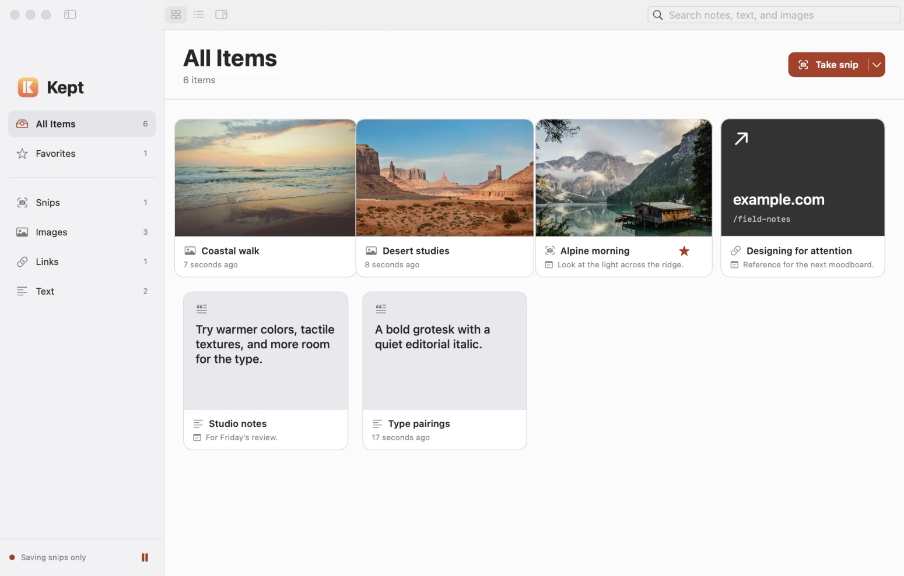

# Kept

Kept is a local-first capture library for macOS. Take a screen snip and paste it immediately while
Kept saves a copy in your library. You can also save images, links, and text, add your own notes,
and search the text inside screenshots.

<picture>
  <source media="(prefers-color-scheme: dark)" srcset="website/assets/library-dark.webp">
  
</picture>

## Build and run

Kept runs on macOS 14 or later. Building from source requires the **Xcode Command Line Tools with
Swift 6 or later**. Run `xcode-select --install` if you need to install the tools.

Run these commands from the repository root.

```sh
scripts/build-app.sh
open build/Kept.app
```

The app bundle includes the Share extension and the `kept-mcp` server.

### Packaged builds

When builds are available, choose the archive for your Mac.

| Mac | Archive |
| --- | --- |
| Apple silicon | `Kept-macOS-arm64.zip` |
| Intel | `Kept-macOS-x86_64.zip` |

When enabled on GitHub, the `Kept builds` workflow tests and packages both architectures on branch
pushes. Successful branch builds publish nightly artifacts in
[Actions](https://github.com/yc-codes/Kept/actions). A new tag, such as `v0.1.0`, publishes both
archives to [Releases](https://github.com/yc-codes/Kept/releases) after both builds pass. CI
archives use ad-hoc signatures and are unnotarized.

## Use Kept

| To | Do this |
| --- | --- |
| Snip part of the screen | Press **⌃⌥S** and drag over the region. Kept saves it and puts the image on your clipboard. |
| Save your current clipboard | Choose **File › Save Clipboard to Library** or press **⌘⇧V** with Kept active. |
| Automatically save copied items | Turn on copied images, links, or text in **Settings › Capture**. Each source is off by default. |
| Import an image or GIF | Drag it into the library, open it with Kept, or choose **File › Import Images…** (**⌘O**). GIFs keep their animation. |
| Save from another app | Open Kept once, then choose **Share › Kept** in the other app. Share one link, image, or selection of text at a time. If Kept is missing, enable it in the Share menu’s extension settings. |
| Find something you saved | Search the library or press **⌃⌥K** to open Quick Search from another app. Search matches titles, saved text and URLs, notes, and text recognized in images. |

Select an item and open the inspector to edit its title or add a note. Use the **Favorites** filter
to find starred items. Change the theme, accent color, card size and other display options in **Settings › Appearance** and the global shortcuts in
**Settings › Shortcuts**.

### Screen capture permissions

With Screen Recording access, Kept opens the macOS region selector directly. Otherwise, select a
display in the system sharing picker, then drag over the preview to choose the region. Press **Esc**
to cancel.

If Kept already appears enabled and capture is refused, open **System Settings › Privacy & Security
› Screen & System Audio Recording**. Toggle Kept off and back on, or remove and re-add your current
copy, then quit and reopen the app.

The local build script reuses a signing identity in
`~/Library/Developer/Kept/kept-signing.keychain-db` so macOS can recognize the app across rebuilds.
To use your own signing identity, set `KEPT_SIGN_IDENTITY` when running `scripts/build-app.sh`.

## Privacy and storage

Kept stores its SQLite database, saved images, and thumbnails in `~/Library/Application
Support/Kept`. Open the folder from **Settings › Capture › Show in Finder**. Image text recognition
runs on your Mac.

Use **Settings › Capture** to exclude apps from automatic clipboard capture. Kept also skips
supported password managers and clipboard items marked private. Pausing clipboard capture leaves
snips, manual saves, and sharing available.

## Connectors

Open **Settings › Connectors › Add Connector** to bring saved links into Kept. You can add several
accounts or feeds. Enabled connections sync on launch and about every 30 minutes. Use **Sync All
Now** to refresh them on demand.

| Connector | What you need | What it saves |
| --- | --- | --- |
| GitHub Stars | A personal access token with read-only Starring access | Starred repositories |
| Raindrop.io | A test token from your Raindrop app settings | Bookmarks |
| RSS or Atom Feed | A feed URL | Feed entries |

Connectors read from their sources and store tokens in the macOS Keychain. Kept skips links already
in the library and remembers delivered entries so the same connection skips them after deletion.
Removing a connector keeps the items it saved.

## Connect an agent

Open **Settings › Agents** and click **Connect** beside Claude Code, Codex, Cursor, or Claude
Desktop. Kept registers its bundled server with that agent, and the agent picks it up in its next
session. To remove it again, choose **Disconnect** from the menu in the same row.

Then capture a few things and hand them over in one line.

```text
Kept fix last 4
```

The agent receives your four latest items in a single call, with the screenshots attached and your
notes alongside, and works through what each one shows. Clients that support MCP prompts also offer
this as a command, such as `/mcp__kept__fix 4` in Claude Code. `/mcp__kept__last 4` brings the items
into the conversation without asking for a fix.

To connect from a terminal, open Kept once and run the command for your agent.

```sh
claude mcp add --scope user kept -- "$HOME/Library/Application Support/Kept/kept-mcp"
codex mcp add kept -- "$HOME/Library/Application Support/Kept/kept-mcp"
```

The path is the same on every Mac. Kept keeps a link there to the server inside the app and updates
it at launch, so the connection survives moving or updating Kept. Other MCP clients can run the same
path over stdio.

The read-only server exposes `get_latest`, `search_library`, `list_recent`, and `get_item`, and the
`fix` and `last` prompts. Results include a `kept://item/<id>` link that opens the saved item in Kept.

An agent using a cloud model can send the library content it reads to its model provider.

## Development

| Path | Contents |
| --- | --- |
| [Sources/Kept](Sources/Kept) | SwiftUI app, capture services, and connectors |
| [Sources/KeptCore](Sources/KeptCore) | Item model, SQLite and full-text search, and image helpers |
| [Sources/KeptMCP](Sources/KeptMCP) | Read-only MCP server |
| [ShareExtension](ShareExtension) | macOS Share extension |
| [Tests](Tests) | Service, browser, and snapshot fixtures and checks |
| [scripts](scripts) | Build, packaging, and test commands |

Set `KEPT_HOME` to point the app and MCP server at a test library. Use `KEPT_DEFAULTS_SUITE` to
isolate app preferences. Either setting also selects a separate Keychain service for connector
sign-ins. `KEPT_GITHUB_API` and `KEPT_RAINDROP_API` can point the connectors at local test servers.
`KEPT_SNAPSHOT_DIR` makes the app render its windows to PNG and exit.

SwiftUI views use the [`@Local` wrapper](Sources/Kept/Views/Local.swift) to support Command Line
Tools builds. The in-app illustrations follow light and dark mode and respect Reduce Motion.

To add a source, implement `verify` and `fetch` on a type that conforms to
[`Connector`](Sources/Kept/Connectors/Connector.swift), then register it in `ConnectorRegistry.all`.

### Tests

Run the macOS suites from a logged-in desktop session with Python 3 and the Command Line Tools
installed.

```sh
scripts/test.sh
scripts/build-app.sh
scripts/test-native-ui.py
```

`test.sh` covers capture settings, clipboard handling, storage, OCR, connectors, MCP, agent
connections, and seeded random sequences. It uses temporary libraries, named pasteboards, a local
HTTP fixture, stand-ins for the agents’ command-line tools, and synthetic Keychain entries that it
removes. Set `KEPT_TEST_SEED=42` to replay one storage sequence.

`test-native-ui.py` checks rendered windows for all five Settings tabs, connector sheets,
onboarding, the library, the inspector, and Quick Search. Global shortcut delivery, live screen
selection, and sharing from another app require interactive testing.

### Website

The static site in [website](website) uses sample data for its interactive demo. To preview it
locally, run the following command and open [localhost:4173](http://localhost:4173).

```sh
python3 -m http.server 4173 --bind 127.0.0.1 --directory website
```

Run the browser tests with Node.js and npm installed.

```sh
npm exec --yes --package=playwright -- playwright install chromium
scripts/test-website.sh
```

Set `KEPT_TEST_CHROME` to an installed Chrome executable to use it in place of Playwright’s
Chromium. Set `KEPT_TEST_SEED=42` to replay one browser sequence.
